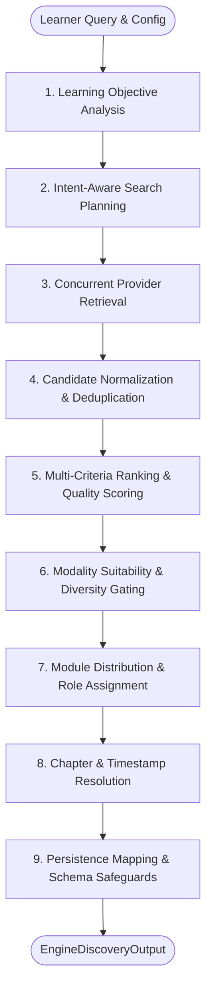

# Pencill — Resource Engine 2.0 Architectural Deep Dive

> **Document Version**: 2.0  
> **Status**: Verified Against Active Source Code & 472 Automated Tests  
> **Core Subsystem**: `src/lib/resource-engine-v2/`

---

## 1. Engine Identity & Runtime Execution Analysis

### 1.1 The Engine Evolution: V1 vs. Shadow vs. V2
An architectural inspection of the repository reveals the history and current runtime reality of Pencill's discovery engines:

1. **Resource Engine V1 (Legacy)**:
   * Originally built as a monolithic procedural pipeline in early milestones.
   * Relied primarily on direct YouTube keyword searches and basic regex filtering.
   * Did not perform multi-modal balancing, objective analysis, or chapter timestamp resolution.
2. **Resource Engine 2.0 (Active Production Engine)**:
   * Located at [`src/lib/resource-engine-v2/`](file:///c:/Users/Abhinav/Documents/Projects/Pencill%20Find%20Your%20Path/src/lib/resource-engine-v2).
   * Fully modular, pipeline-oriented architecture consisting of 11 distinct domain packages: `analysis`, `planning`, `providers`, `educators`, `normalization`, `evaluation`, `chapters`, `distribution`, `persistence`, `resilience`, and `bridge`.
   * Introduces cognitive intent classification, master educator matching, duration calibration, chapter extraction, pre-write persistence safeguards, and quota circuit breakers.
3. **Bridge & Shadow Architecture**:
   * [`src/lib/resource-engine-v2/bridge/engine-router.ts`](file:///c:/Users/Abhinav/Documents/Projects/Pencill%20Find%20Your%20Path/src/lib/resource-engine-v2/bridge/engine-router.ts) provides a runtime router with three operating modes:
     * `'v1'`: Executes legacy pipeline.
     * `'shadow'`: Executes V1 for user responses, asynchronously dry-runs V2 with `saveToDatabase: false`, and logs Jaccard URL similarity metrics.
     * `'v2'`: Directly executes Resource Engine 2.0 with automatic fallback to V1 on unhandled exceptions.
   * [`src/lib/resource-engine-v2/bridge/compatibility-adapter.ts`](file:///c:/Users/Abhinav/Documents/Projects/Pencill%20Find%20Your%20Path/src/lib/resource-engine-v2/bridge/compatibility-adapter.ts) bridges modern `EngineDiscoveryOutput` data models into the public `DiscoverResponse` contract expected by the frontend.

### 1.2 Which Engine Executes at Runtime?
**Resource Engine 2.0 is the active engine executed by the application.**

In [`src/app/api/resources/discover/route.ts`](file:///c:/Users/Abhinav/Documents/Projects/Pencill%20Find%20Your%20Path/src/app/api/resources/discover/route.ts#L104-L258):
```typescript
const v2Engine = new ResourceEngineV2();

// Direct V2 Execution
const v2Output = await v2Engine.discover({
  query,
  academicLevel: level,
  level,
  domain: body.domain || undefined,
  targetExam: options.examContext,
  language,
  modalities: modalitiesList as any,
  limit: options.limit,
  saveToDatabase: options.saveToDatabase,
  timeoutMs: options.timeoutMs,
  modules: modulesInput,
});

// Format via Compatibility Adapter
const formattedResponse = adaptV2ToDiscoverResponse(v2Output, {
  learningPathTemplate: learningPath,
});
```

The UI (`/new-goal`) and all resource API routes (`/api/resources/discover`, `/api/resources/search`, `/api/resources/notes`, `/api/resources/evaluate`, `/api/resources/practice`) invoke Resource Engine 2.0.

---

## 2. Complete Resource Engine 2.0 Pipeline

The Resource Engine operates as a 10-stage deterministic pipeline.



---

### Stage 1: Learning Objective Analysis
* **File**: [`src/lib/resource-engine-v2/analysis/objective-analyzer.ts`](file:///c:/Users/Abhinav/Documents/Projects/Pencill%20Find%20Your%20Path/src/lib/resource-engine-v2/analysis/objective-analyzer.ts)
* **Entry Function**: `LearningObjectiveAnalyzer.analyze(input: ObjectiveAnalysisInput)`
* **Inputs**: `moduleTitle`, `courseTitle`, `academicLevel`, `targetExam`, `preferredLanguage`, `domainHint`.
* **Outputs**: `AnalyzedObjective` containing:
  * `domain`: Classified academic domain (`computer_science`, `physics`, `mathematics`, `chemistry`, `school_education`, `general_academic`).
  * `cognitiveIntent`: Inferred pedagogical intent (`foundational_intro`, `in_depth_conceptual`, `coding_walkthrough`, `project_implementation`, `worked_examples`, `exam_practice`).
  * `primaryConcepts`: Extracted technical key concepts (e.g. `['Vectors', 'Dot Product', 'Cross Product']`).
  * `prerequisites`: Inferred conceptual prerequisites.
  * `intentProfile`: Practical emphasis tier (`primary`, `high`, `moderate`, `none`).
* **Algorithm**:
  Uses heuristic token analysis and regular expression classifiers to map topics to canonical domains and intents without requiring an external LLM call.

---

### Stage 2: Intent-Aware Search Planning
* **File**: [`src/lib/resource-engine-v2/planning/search-planner.ts`](file:///c:/Users/Abhinav/Documents/Projects/Pencill%20Find%20Your%20Path/src/lib/resource-engine-v2/planning/search-planner.ts)
* **Entry Function**: `IntentAwareSearchPlanner.plan(objective: AnalyzedObjective, options?: SearchPlannerOptions)`
* **Inputs**: `AnalyzedObjective`.
* **Outputs**: Array of `SearchQueryItem` (query string, target modality, target provider compatibility, intent, priority).
* **Strategy**:
  * For `coding_walkthrough`: Generates practical queries targeting YouTube with qualifiers like `"tutorial"`, `"step by step"`, `"code walkthrough"`.
  * For `in_depth_conceptual`: Formulates queries targeting MIT OCW, NPTEL, and academic notes repositories.
  * For exam contexts (e.g. JEE/NEET): Formulates queries incorporating exam acronyms and PYQ patterns.
  * Runs [`query-deduplicator.ts`](file:///c:/Users/Abhinav/Documents/Projects/Pencill%20Find%20Your%20Path/src/lib/resource-engine-v2/planning/query-deduplicator.ts) to eliminate duplicate queries across providers.

---

### Stage 3: Concurrent Provider Retrieval
* **File**: [`src/lib/resource-engine-v2/orchestrator.ts`](file:///c:/Users/Abhinav/Documents/Projects/Pencill%20Find%20Your%20Path/src/lib/resource-engine-v2/orchestrator.ts#L249-L312) & [`providers/`](file:///c:/Users/Abhinav/Documents/Projects/Pencill%20Find%20Your%20Path/src/lib/resource-engine-v2/providers)
* **Execution**: Executes tasks via `runWithConcurrencyLimit(tasks, 4)`.
* **Integrated Providers**:
  1. **YouTubeAdapterV2**: Calls YouTube Data API v3 `/search`, `/videos`, and `/playlistItems`. Enforces `status.embeddable == true` and parses ISO durations (`PT1H20M`).
  2. **EducatorRegistry / Master Dataset**: Queries the 60+ seeded institutional educators (NPTEL, MIT OCW, Khan Academy, 3Blue1Brown, Striver, Abdul Bari, CS50).
  3. **AcademicNotesProvider**: Queries Wikimedia API, arXiv API, OpenAlex API, and official curriculum endpoints (NCERT, MIT OCW).
  4. **GoogleSearchProvider**: Queries Google Custom Search JSON API with circuit-breaker tracking.
* **Resilience**:
  Each provider call is bounded by `timeoutMs` (default 20–45s). If a provider fails or trips a circuit breaker, errors are recorded in `partialFailures`, and the engine proceeds with remaining candidates.

---

### Stage 4: Candidate Normalization & Deduplication
* **Files**: [`normalizer.ts`](file:///c:/Users/Abhinav/Documents/Projects/Pencill%20Find%20Your%20Path/src/lib/resource-engine-v2/normalization/normalizer.ts), [`deduplication-engine.ts`](file:///c:/Users/Abhinav/Documents/Projects/Pencill%20Find%20Your%20Path/src/lib/resource-engine-v2/normalization/deduplication-engine.ts), [`url-normalizer.ts`](file:///c:/Users/Abhinav/Documents/Projects/Pencill%20Find%20Your%20Path/src/lib/resource-engine-v2/normalization/url-normalizer.ts).
* **Normalization**:
  Converts disparate API responses into standard `NormalizedResourceCandidate` records with validated canonical URLs, parsed durations in seconds, creator profiles, and verification badges.
* **Deduplication Invariant**:
  Rejects candidates with identical YouTube Video IDs, identical Playlist IDs, or normalized URL collations (`https://youtu.be/xyz` == `https://www.youtube.com/watch?v=xyz`).

---

### Stage 5: Multi-Criteria Ranking & Quality Scoring
* **File**: [`src/lib/resource-engine-v2/evaluation/ranking-engine.ts`](file:///c:/Users/Abhinav/Documents/Projects/Pencill%20Find%20Your%20Path/src/lib/resource-engine-v2/evaluation/ranking-engine.ts)
* **Entry Function**: `ExplainableRankingEngine.rank(objective, candidates, options)`
* **Exact Composite Scoring Equation**:
  $$S_{\text{overall}} = \text{clamp}\left(0, 100, \left[ S_{\text{rel}} \cdot w_{\text{rel}} + S_{\text{depth}} \cdot w_{\text{depth}} + S_{\text{dur}} \cdot w_{\text{dur}} + S_{\text{cov}} \cdot w_{\text{cov}} + \text{Bonus} - \text{Penalty} \right]\right)$$

* **Standard Weights (Normalized to sum to 1.0)**:
  * $w_{\text{rel}} = 0.50$ (Topic & Concept Relevance)
  * $w_{\text{depth}} = 0.25$ (Educational Depth & Credibility)
  * $w_{\text{dur}} = 0.15$ (Duration Suitability against Pedagogical Intent)
  * $w_{\text{cov}} = 0.10$ (Objective Concept Coverage Ratio)

* **Worked Numerical Example**:
  Evaluating a 45-minute Abdul Bari lecture on *"Dynamic Programming: Bellman-Ford Algorithm"*:
  1. Relevance Scorer matches query tokens and concepts: $S_{\text{rel}} = 92 / 100$.
  2. Depth Evaluator rates pedagogical authority and master educator status: $S_{\text{depth}} = 95 / 100$.
  3. Duration Intelligence: 45 minutes is optimal for an advanced algorithmic walkthrough: $S_{\text{dur}} = 92 / 100$.
  4. Concept Coverage: Lecture covers 3 of 3 requested subtopics: $S_{\text{cov}} = 100 / 100$.
  5. Category Alignment Bonus: Practical coding / algorithm derivation (+8 points).
  6. Buzzword Penalty: 0 points.
  $$\text{Composite} = (92 \times 0.50) + (95 \times 0.25) + (92 \times 0.15) + (100 \times 0.10) + 8 = 46.0 + 23.75 + 13.8 + 10.0 + 8 = 101.55 \xrightarrow{\text{clamp}} 100$$
  The candidate earns a final score of **100/100** and is slotted as the flagship core video.

---

### Stage 6: Modality Suitability & Diversity Gating
* **File**: [`ranking-engine.ts`](file:///c:/Users/Abhinav/Documents/Projects/Pencill%20Find%20Your%20Path/src/lib/resource-engine-v2/evaluation/ranking-engine.ts#L20-L71)
* **Function**: `isModalityAppropriateForObjective(modality, objective)`
* **Pedagogical Gating Rules**:
  * **Academic Research Papers (`paper`)**: STRICTLY REJECTED for beginner levels, high school board exams (CBSE, ICSE), or practical coding walkthroughs. Papers are only allowed for undergraduate advanced, postgraduate, or research intent.
  * **Official Documentation (`documentation`)**: Prioritized for Computer Science, programming languages, and web engineering.
  * **Practice Sets (`practice`)**: Required when target exams or worked examples are requested.
* **Slotting**:
  Guarantees that high-scoring text monographs or official documentation are slotted alongside top video lectures (slot #3), preventing the course from becoming 100% video or 100% text.

---

### Stage 7: Module Distribution & Role Assignment
* **File**: [`src/lib/resource-engine-v2/distribution/module-distributor.ts`](file:///c:/Users/Abhinav/Documents/Projects/Pencill%20Find%20Your%20Path/src/lib/resource-engine-v2/distribution/module-distributor.ts)
* **Entry Function**: `ResourceModuleDistributor.distribute(modules, candidates, options)`
* **Role Assignment**:
  Assigns candidates to specific pedagogical roles within each module:
  1. `core_concept_video`: The primary lecture introducing foundational axioms.
  2. `deep_dive_monograph`: Structured reading notes or textbook chapter.
  3. `practice_problem_set`: Step-by-step worked examples or exam questions.
  4. `supplementary_reference`: Alternative derivation or visual simulation.
* **Cross-Module Duplicate Prevention**:
  Once a video or URL is assigned to Module 1, it is quarantined. Subsequent modules cannot receive the same video unless it represents a long lecture with distinct timestamped chapters.

---

### Stage 8: Chapter & Timestamp Resolution
* **File**: [`src/lib/resource-engine-v2/chapters/chapter-resolver.ts`](file:///c:/Users/Abhinav/Documents/Projects/Pencill%20Find%20Your%20Path/src/lib/resource-engine-v2/chapters/chapter-resolver.ts)
* **Execution**:
  For comprehensive lectures exceeding 15 minutes, the engine inspects the YouTube video description.
* **Regex Parser**:
  Matches timestamp markers (e.g. `(?:^|\n)(?:(\d{1,2}):)?(\d{2}):(\d{2})\s+[-–:]?\s*(.+)$`):
  * `00:00 Introduction` -> `0s`
  * `14:22 Kinetics & Rate Law` -> `862s`
  * `32:10 Stereochemistry in SN2` -> `1930s`
* **Outcome**:
  Injects structured `chapters` into lesson records and appends `&start=862` to video embed URLs so learners land directly on the relevant concept.

---

### Stage 9: Persistence Mapping & Schema Safeguards
* **Files**: [`persistence-mapper.ts`](file:///c:/Users/Abhinav/Documents/Projects/Pencill%20Find%20Your%20Path/src/lib/resource-engine-v2/persistence/persistence-mapper.ts), [`persistence-safeguards.ts`](file:///c:/Users/Abhinav/Documents/Projects/Pencill%20Find%20Your%20Path/src/lib/resource-engine-v2/persistence/persistence-safeguards.ts).
* **Validation**:
  Runs a pre-write audit validating that:
  1. Every module has at least one valid lesson.
  2. Every lesson has a non-empty canonical URL starting with `http`.
  3. No generic YouTube channel pages (`/videos`, `/playlists`) exist.
  4. Durations are positive integers.
* **Output**: Returns verified `PersistenceMappingResult` ready for atomic insertion into Supabase.

---

## 3. AI Integration: Gemini Model Cascades & Prompt Architecture

### 3.1 Supported Models & Model Cascades
Pencill integrates Google Gemini Generative Language API via direct REST calls in [`src/services/ai/gemini/client.ts`](file:///c:/Users/Abhinav/Documents/Projects/Pencill%20Find%20Your%20Path/src/services/ai/gemini/client.ts).

To protect against cloud outages and quota spikes, the client implements an automatic **Model Fallback Cascade**:
1. **Primary Model**: `gemini-3.8-flash` (Optimized for speed and high reasoning).
2. **First Fallback**: `gemini-3.5-flash` (Triggered on HTTP 503 high demand or timeouts).
3. **Second Fallback**: `gemini-flash-latest` (Last-resort cloud model).
4. **Deterministic Local Fallback**: [`createTopicAdaptiveCurriculum()`](file:///c:/Users/Abhinav/Documents/Projects/Pencill%20Find%20Your%20Path/src/services/ai/curriculum-adaptive-engine.ts) (Triggered if all cloud models are unavailable).

### 3.2 Prompt Construction & Quality Invariants
In [`src/services/ai/gemini/geminiProvider.ts`](file:///c:/Users/Abhinav/Documents/Projects/Pencill%20Find%20Your%20Path/src/services/ai/gemini/geminiProvider.ts#L66-L115):
* **System Instruction**: Enforces role as Chief Academic Curriculum Architect with zero superficial fluff.
* **Module Count Directive**: Dynamically calibrated using `analyzeTopicComplexity`:
  * Narrow single-concept subjects (e.g. Python Decorators, Binary Search): 2 to 3 cohesive modules.
  * Focused foundational subjects (e.g. Python Programming, Git Basics): 3 to 4 cohesive modules.
  * Intermediate multi-concept subjects (e.g. Linear Algebra, DSA): 4 to 5 cohesive modules.
  * Frontier disciplines (e.g. Fine-Tuning LLMs, Machine Learning): 5 to 6 cohesive modules.
* **Pedagogical Cohesion**: Directs the LLM to combine related concepts (e.g., unify LoRA, QLoRA, and PEFT into one module) rather than creating fragmented 1-lesson modules.
* **LaTeX Formula Notation**: Mandates standard LaTeX notation (`$E = mc^2$`) for all math and science equations.

### 3.3 Output Parsing & JSON Extraction
In [`src/lib/resource-engine-v2/utils/text-utils.ts`](file:///c:/Users/Abhinav/Documents/Projects/Pencill%20Find%20Your%20Path/src/lib/resource-engine-v2/utils/text-utils.ts):
The function `extractJsonFromText<T>(rawText)` handles:
1. Markdown code fences (` ```json ... ``` `).
2. Unescaped backslashes in LaTeX formulae (e.g., `\frac`, `\alpha`), automatically sanitizing them before invoking `JSON.parse`.
3. Truncated outputs from token limits.

---

## 4. Practical vs. Theoretical Topic Handling

The engine behaves fundamentally differently based on the academic domain:

| Behavior Dimension | Practical Topics (e.g. Python, React, Docker, SQL) | Theoretical Topics (e.g. Real Analysis, Differential Equations) |
| :--- | :--- | :--- |
| **Duration Calibration** | 12–25 min hands-on walkthroughs receive maximum score ($S_{\text{dur}} \ge 92$) | 45–60 min complete derivations receive maximum score ($S_{\text{dur}} \ge 95$) |
| **Modality Selection** | Prioritizes official docs (`docs.python.org`, `react.dev`) and code walkthroughs | Prioritizes university lecture notes (MIT OCW, NPTEL) and textbooks |
| **Paper Suitability** | Research papers are strictly penalized (-25 points) | Research papers and seminal monographs are allowed for advanced tiers |
| **Buzzword Penalty** | Videos with clickbait keywords ("Learn in 10 mins") without code examples are penalized | Summaries lacking formal mathematical proofs are rejected |

---

## 5. Diagnostic Checkpoints & Quiz Grounding

### The Grounding Reality:
* **Current Implementation**: Quizzes generated via `/api/quizzes/generate` or `/api/resources/discover` are grounded in **module-specific learning objectives, key concepts, and curriculum subtopics**.
* **Distinction**: Quizzes are NOT grounded in word-for-word automated video transcript parsing. Videos are third-party YouTube streams; the quiz tests the conceptual milestone defined in the syllabus.
* **Pedagogical Invariant**: Each diagnostic checkpoint contains 4 multiple-choice questions with full distractor rationales explaining why incorrect options are conceptually flawed. Authoritative answers are isolated on the server until submission.

---

## 6. Resource Engine Failure Modes & Recovery Matrix

| Failure Mode | Root Cause | Actual System Behavior |
| :--- | :--- | :--- |
| **Gemini API 503** | Google Cloud high demand spike | Retries with candidate cascade (`gemini-3.5-flash`); if all fail, switches to `createTopicAdaptiveCurriculum()` |
| **Gemini JSON Parse Error**| Malformed JSON from model | `extractJsonFromText` repairs unescaped LaTeX slashes; if unfixable, falls back to deterministic curriculum |
| **YouTube Quota Exhausted (403)** | 10,000 units/day quota exceeded | Circuit breaker trips for 60s; provider immediately switches to verified Master Educator Directory |
| **Unplayable / Embed-Disabled Video**| Creator disabled YouTube iframe embedding | `ValidationEngine` checks `status.embeddable == false` and discards the candidate during retrieval |
| **Zero Resources Found**| Extremely obscure query | System returns an honest empty state with suggestions rather than injecting fake or fabricated links |
| **Network Timeout** | Slow external provider API | Worker aborts after `timeoutMs` (45s); returns whatever resources were successfully retrieved |
| **Supabase Unreachable**| Database maintenance or offline dev | Writes course to `inMemoryPathCache` and browser `localStorage`; returns course ID so UI continues seamlessly |
