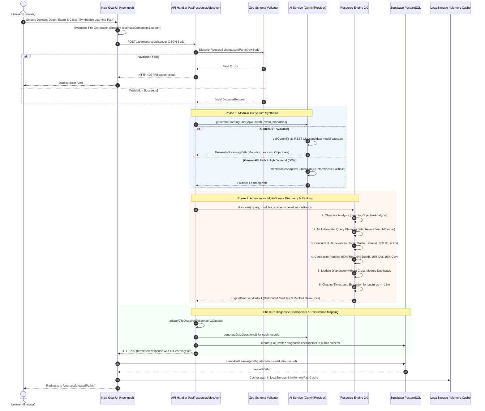
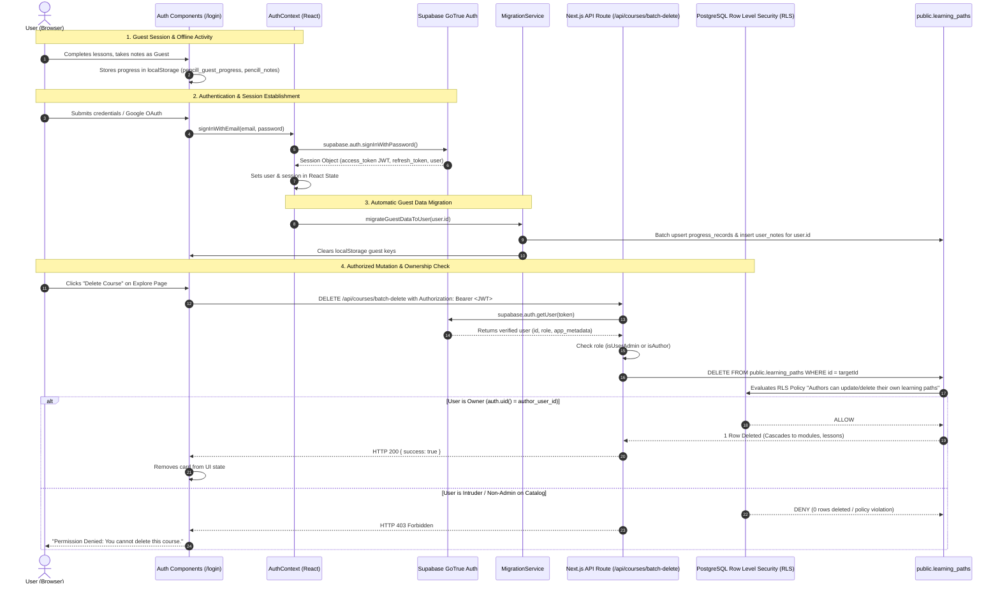

# Pencill — Complete System Architecture

> **Document Version**: 2.0  
> **Architecture Pattern**: Hybrid Jamstack / React Server Components + REST API Routes + Resilient Multi-Provider Discovery Pipeline + BaaS PostgreSQL with Row Level Security.

---

## 1. High-Level System Architecture

Pencill operates on a decoupled full-stack architecture built on Next.js 14 and Supabase PostgreSQL. It bridges generative artificial intelligence with deterministic information retrieval algorithms.

### Diagram A: High-Level System Architecture

```mermaid
flowchart TD
    subgraph BrowserClient["Browser Client (React 18 / Next.js 14)"]
        UI_Home["Landing / Marketing (/)"]
        UI_Dash["Dashboard (/dashboard)"]
        UI_Builder["Universal Builder (/new-goal)"]
        UI_Learn["3-Pane Workspace (/learn)"]
        UI_Quiz["Quiz Room (/practice)"]
        AuthCtx["AuthContext & LocalStorage Cache"]
    end

    subgraph NextServer["Next.js Application Server (Node.js)"]
        subgraph APILayer["API Route Handlers (src/app/api)"]
        API_Discover["POST /api/resources/discover"]
        API_Search["POST /api/resources/search"]
        API_Notes["POST /api/resources/notes"]
        API_QuizGen["POST /api/quizzes/generate"]
        API_QuizSub["POST /api/quizzes/submit"]
        API_BatchDel["POST /api/courses/batch-delete"]
        API_Enroll["GET/POST /api/enrollments"]
    end

    subgraph CoreServices["Business Logic & Service Layer"]
        AIService["AI Service & Adaptive Engine"]
        PathService["Path & Course Service"]
        QuizService["Quiz Assessment Service"]
        DeletionReg["Deletion Registry"]
        EnrollmentService["Multi-Tier Enrollment Service"]
    end

    subgraph ResourceEngineV2["Resource Engine 2.0 Subsystem"]
        Orchestrator["ResourceEngineV2 Orchestrator"]
        ObjAnalyzer["Objective Analyzer"]
        SearchPlanner["Search Planner"]
        ProviderRegistry["Provider Registry & Circuit Breakers"]
        RankingEngine["Explainable Ranking Engine"]
        ModDistributor["Module Distributor"]
        PersistMapper["Persistence Mapper & Safeguards"]
    end
    end

    subgraph ExternalAPIs["External Cloud APIs & Services"]
        GeminiAPI["Google Gemini REST API (gemini-3.8/3.5-flash)"]
        YouTubeAPI["YouTube Data API v3 (Search, Videos, Playlists)"]
        GoogleSearchAPI["Google Custom Search JSON API"]
        OpenAlexAPI["OpenAlex Bibliographic API"]
        ArXivAPI["arXiv e-Print API"]
        NCERT["NCERT & Official Docs Repositories"]
    end

    subgraph PersistenceLayer["Authoritative Data Layer (Supabase / Local)"]
        SupaAuth["Supabase GoTrue Auth (JWT)"]
        PostgresDB[("Supabase PostgreSQL Database (with RLS)")]
        LocalLedger[("data/enrollments.json & deleted_records.json")]
    end

    %% Client to Server Routes
    UI_Builder -->|"POST (Goal & Config)"| API_Discover
    UI_Learn -->|"GET/POST (Notes, Progress)"| API_Notes
    UI_Quiz -->|"POST (Submit Answers)"| API_QuizSub
    UI_Dash -->|"GET (Enrollments)"| API_Enroll
    UI_Home -->|"Auth Triggers"| AuthCtx

    %% API to Service Layer
    API_Discover --> AIService
    API_Discover --> Orchestrator
    API_Discover --> PathService
    API_QuizGen --> AIService
    API_QuizGen --> QuizService
    API_QuizSub --> QuizService
    API_BatchDel --> PathService
    API_BatchDel --> DeletionReg
    API_Enroll --> EnrollmentService

    %% Resource Engine Internal Flow
    Orchestrator --> ObjAnalyzer
    ObjAnalyzer --> SearchPlanner
    SearchPlanner --> ProviderRegistry
    ProviderRegistry --> RankingEngine
    RankingEngine --> ModDistributor
    ModDistributor --> PersistMapper

    %% Services & Engine to External APIs
    AIService -->|"REST (HTTPS x-goog-api-key)"| GeminiAPI
    ProviderRegistry -->|"HTTPS"| YouTubeAPI
    ProviderRegistry -->|"HTTPS"| GoogleSearchAPI
    ProviderRegistry -->|"HTTPS"| OpenAlexAPI
    ProviderRegistry -->|"HTTPS"| ArXivAPI
    ProviderRegistry -->|"HTTP/HTTPS"| NCERT

    %% Data Access to Persistence
    AuthCtx <-->|"Session Tokens (JWT)"| SupaAuth
    PathService <-->|"SQL via PostgREST / RLS"| PostgresDB
    QuizService <-->|"SQL via PostgREST / RLS"| PostgresDB
    EnrollmentService <-->|"SQL / File"| PostgresDB
    EnrollmentService <-->|"Fallback Local Store"| LocalLedger
    DeletionReg <-->|"Marker Rows"| PostgresDB
    DeletionReg <-->|"Fallback JSON"| LocalLedger
```

### Connection Details & Architectural Roles
1. **Client to API Layer**: The Next.js client renders responsive UI components that communicate with the server-side API layer using `fetch` with JSON payloads. The client never holds API keys for Gemini, YouTube, or Google Search.
2. **API Layer to Business Services**: Server route handlers parse and validate request payloads with Zod (`src/lib/api-schemas.ts`). If valid, execution is delegated to the appropriate domain service (`pathService`, `quizService`, or `ResourceEngineV2`).
3. **Resource Engine 2.0 to External Providers**: The engine manages provider adapters (`youtube-adapter`, `academic-notes-provider`, `google-search-provider`, `arxiv-adapter`, `openalex-adapter`). Every outbound call is bounded by timeouts and monitored by circuit breakers.
4. **Services to Database**: Database calls execute via `@supabase/supabase-js`. Mutations from authenticated users transmit Bearer JWT tokens to ensure Row Level Security policies are evaluated in PostgreSQL.

---

## 2. Application Request Lifecycle

### Diagram B: Application Request Lifecycle

---

## 3. Module Dependency Graph

### Diagram C: Module Dependency Graph

```mermaid
graph TD
    subgraph UIComponents["UI Layer (Client)"]
        Page_NewGoal["app/new-goal/page.tsx"]
        Page_Learn["app/learn/[courseId]/[lessonId]/page.tsx"]
        Page_Practice["app/practice/[quizId]/page.tsx"]
        Page_Explore["app/explore/page.tsx"]
        Comp_Builder["components/builder/*"]
    end

    subgraph APIEndpoints["API Routes (Server)"]
        Route_Discover["api/resources/discover/route.ts"]
        Route_Notes["api/resources/notes/route.ts"]
        Route_QuizGen["api/quizzes/generate/route.ts"]
        Route_BatchDel["api/courses/batch-delete/route.ts"]
    end

    subgraph AISubsystem["AI Subsystem"]
        AI_Client["services/ai/gemini/client.ts"]
        AI_Provider["services/ai/gemini/geminiProvider.ts"]
        AI_Adaptive["services/ai/curriculum-adaptive-engine.ts"]
    end

    subgraph ResourceEngineV2Subsystem["Resource Engine 2.0"]
        RE_Orchestrator["resource-engine-v2/orchestrator.ts"]
        RE_Analysis["resource-engine-v2/analysis/*"]
        RE_Planning["resource-engine-v2/planning/*"]
        RE_Providers["resource-engine-v2/providers/*"]
        RE_Educators["resource-engine-v2/educators/*"]
        RE_Eval["resource-engine-v2/evaluation/*"]
        RE_Norm["resource-engine-v2/normalization/*"]
        RE_Chapters["resource-engine-v2/chapters/*"]
        RE_Dist["resource-engine-v2/distribution/*"]
        RE_Persist["resource-engine-v2/persistence/*"]
        RE_Resilience["resource-engine-v2/resilience/*"]
        RE_Bridge["resource-engine-v2/bridge/*"]
    end

    subgraph Services["Services & Data Layer"]
        Svc_Path["services/supabase/pathService.ts"]
        Svc_Quiz["services/supabase/quizService.ts"]
        Svc_Enroll["services/supabase/enrollmentService.ts"]
        Svc_Client["services/supabase/client.ts"]
        Svc_DelReg["services/supabase/deletionRegistry.ts"]
        Svc_Migrate["services/supabase/migrationService.ts"]
    end

    subgraph CatalogsAndLib["Catalogs & Shared Lib"]
        Lib_Schemas["lib/api-schemas.ts"]
        Lib_Permissions["lib/permissions.ts"]
        Lib_Env["lib/env.ts"]
        Lib_DomainCat["lib/catalogs/domainCatalog.ts"]
        Lib_Estimator["lib/curriculum/blueprintEstimator.ts"]
    end

    %% Dependencies
    Page_NewGoal --> Comp_Builder
    Page_NewGoal --> Lib_Estimator
    Page_NewGoal --> Svc_Path
    Comp_Builder --> Lib_DomainCat

    Route_Discover --> Lib_Schemas
    Route_Discover --> RE_Orchestrator
    Route_Discover --> AI_Provider
    Route_Discover --> AI_Adaptive
    Route_Discover --> Svc_Quiz

    AI_Provider --> AI_Client
    AI_Provider --> AI_Adaptive
    AI_Client --> Lib_Env

    RE_Orchestrator --> RE_Analysis
    RE_Orchestrator --> RE_Planning
    RE_Orchestrator --> RE_Providers
    RE_Orchestrator --> RE_Eval
    RE_Orchestrator --> RE_Dist
    RE_Orchestrator --> RE_Chapters
    RE_Orchestrator --> RE_Persist
    RE_Providers --> RE_Educators
    RE_Providers --> RE_Resilience
    RE_Providers --> RE_Norm
    RE_Eval --> RE_Educators

    Route_BatchDel --> Lib_Permissions
    Route_BatchDel --> Svc_Path
    Route_BatchDel --> Svc_DelReg

    Svc_Path --> Svc_Client
    Svc_Path --> Svc_DelReg
    Svc_Quiz --> Svc_Client
    Svc_Quiz --> Svc_DelReg
    Svc_Enroll --> Svc_Client
    Svc_Enroll --> Svc_DelReg
```

---

## 4. Authentication and Authorization Flow

### Diagram D: Authentication & Authorization Flow

---

## 5. Data Architecture (Entity-Relationship Diagram)

Pencill utilizes 12 relational tables in PostgreSQL managed by Supabase migrations, strictly separated between public catalog entities and private learner records.

### Diagram E: Verified Database Entity-Relationship Diagram

```mermaid
erDiagram
    PROFILES ||--o{ LEARNING_PATHS : "authors"
    PROFILES ||--o{ PROGRESS_RECORDS : "tracks"
    PROFILES ||--o{ BOOKMARKS : "saves"
    PROFILES ||--o{ USER_NOTES : "writes"
    PROFILES ||--o{ QUIZ_ATTEMPTS : "completes"
    PROFILES ||--o{ ENROLLMENTS : "registers"
    PROFILES ||--o{ AI_GENERATION_RECORDS : "requests"

    LEARNING_PATHS ||--|{ MODULES : "contains (1:N)"
    LEARNING_PATHS ||--o{ ENROLLMENTS : "has (1:N)"
    LEARNING_PATHS ||--o{ QUIZZES : "has checkpoints (1:N)"
    LEARNING_PATHS ||--o{ BOOKMARKS : "referenced by"
    LEARNING_PATHS ||--o{ USER_NOTES : "referenced by"

    MODULES ||--|{ LESSONS : "contains (1:N)"
    MODULES ||--o{ PROGRESS_RECORDS : "tracks"

    LESSONS ||--o{ PROGRESS_RECORDS : "records completion"
    LESSONS ||--o{ USER_NOTES : "annotated by"
    LESSONS ||--o{ BOOKMARKS : "bookmarked by"

    QUIZZES ||--|{ QUIZ_QUESTIONS : "contains (1:N)"
    QUIZZES ||--o{ QUIZ_ATTEMPTS : "evaluated by (1:N)"

    MASTER_EDUCATORS ||--o{ RESOURCES : "published by"

    PROFILES {
        UUID id PK "REFERENCES auth.users(id)"
        TEXT name
        TEXT grade
        TEXT avatar_url
        TEXT target_exam
        TEXT tier "DEFAULT 'Pro Path'"
        INTEGER streak_days
        INTEGER longest_streak_days
        NUMERIC weekly_goal_hours
        TIMESTAMPTZ created_at
        TIMESTAMPTZ updated_at
    }

    LEARNING_PATHS {
        TEXT id PK "e.g. 'jee-physics-mvlv7maf'"
        TEXT title
        TEXT description
        TEXT domain "e.g. 'Physics', 'Computer Science'"
        TEXT level "e.g. 'Class 11', 'Undergraduate'"
        INTEGER duration_hours
        INTEGER module_count
        BOOLEAN verified
        INTEGER enrolled_count
        TEXT average_completion
        TEXT syllabus_note
        TEXT_ARRAY tags
        JSONB weekly_checkpoint
        BOOLEAN is_published
        UUID author_user_id FK "NULL = System Curated"
        TIMESTAMPTZ created_at
        TIMESTAMPTZ updated_at
    }

    MODULES {
        TEXT id PK "e.g. 'mod-jee-physics-1'"
        TEXT path_id FK "REFERENCES learning_paths(id) ON DELETE CASCADE"
        TEXT title
        INTEGER module_number
        INTEGER order_index
        TEXT status "CHECK ('completed', 'in_progress', 'locked')"
        INTEGER total_resources
        TIMESTAMPTZ created_at
        TIMESTAMPTZ updated_at
    }

    LESSONS {
        TEXT id PK "e.g. 'les-mod-jee-physics-1-1'"
        TEXT module_id FK "REFERENCES modules(id) ON DELETE CASCADE"
        TEXT title
        TEXT type "CHECK ('video', 'monograph', 'practice', 'quiz', 'paper', 'formulae')"
        INTEGER duration_minutes
        TEXT source_name
        TEXT source_url
        INTEGER order_index
        TEXT concept_id
        TEXT prerequisites_note
        JSONB chapters "Array of {title, timestampSeconds}"
        JSONB formulae "Array of {name, latex, notes}"
        TEXT_ARRAY summary_points
        TEXT educator_id FK "REFERENCES master_educators(educator_id)"
        TEXT discovery_source "e.g. 'curated_directory'"
        TIMESTAMPTZ created_at
        TIMESTAMPTZ updated_at
    }

    RESOURCES {
        TEXT id PK
        TEXT title
        TEXT type
        INTEGER duration_minutes
        TEXT source_name
        TEXT source_url
        TEXT description
        TEXT external_id
        NUMERIC quality_score
        BOOLEAN is_verified
        TEXT educator_id FK
        TEXT discovery_source
        TIMESTAMPTZ created_at
    }

    MASTER_EDUCATORS {
        UUID id PK
        TEXT educator_id UK "e.g. 'EDU-001'"
        TEXT educator_name
        TEXT educator_type
        TEXT youtube_channel_name
        TEXT youtube_channel_id
        TEXT official_channel_url
        TEXT primary_domain
        TEXT_ARRAY subjects
        TEXT_ARRAY relevant_examinations
        TEXT country
        TEXT primary_language
        BOOLEAN complete_course_available
        TEXT verification_status
        DATE last_verified_date
    }

    ENROLLMENTS {
        UUID id PK
        UUID user_id FK "REFERENCES auth.users(id) ON DELETE CASCADE"
        TEXT course_id FK "REFERENCES learning_paths(id) ON DELETE CASCADE"
        TIMESTAMPTZ enrolled_at
        TEXT completion_status "CHECK ('enrolled', 'in_progress', 'completed', 'archived')"
        NUMERIC progress_percent
        TIMESTAMPTZ last_accessed_at
    }

    PROGRESS_RECORDS {
        UUID id PK
        UUID user_id FK "REFERENCES auth.users(id) ON DELETE CASCADE"
        TEXT lesson_id FK "REFERENCES lessons(id) ON DELETE CASCADE"
        TEXT module_id FK "REFERENCES modules(id) ON DELETE CASCADE"
        TEXT path_id FK "REFERENCES learning_paths(id) ON DELETE CASCADE"
        BOOLEAN is_completed
        TIMESTAMPTZ completed_at
        INTEGER time_spent_seconds
        TIMESTAMPTZ last_accessed_at
    }

    BOOKMARKS {
        UUID id PK
        UUID user_id FK "REFERENCES auth.users(id) ON DELETE CASCADE"
        TEXT resource_id FK "REFERENCES lessons(id) ON DELETE SET NULL"
        TEXT path_id FK "REFERENCES learning_paths(id) ON DELETE CASCADE"
        TEXT title
        TEXT type
        TEXT source
        TEXT category "CHECK ('video', 'monograph', 'practice', 'formulae', 'path')"
        TEXT notes
        TIMESTAMPTZ created_at
    }

    USER_NOTES {
        UUID id PK
        UUID user_id FK "REFERENCES auth.users(id) ON DELETE CASCADE"
        TEXT lesson_id FK "REFERENCES lessons(id) ON DELETE CASCADE"
        TEXT path_id FK "REFERENCES learning_paths(id) ON DELETE CASCADE"
        TEXT timestamp_marker "e.g. '14:22'"
        INTEGER seconds_marker
        TEXT content
        TIMESTAMPTZ created_at
        TIMESTAMPTZ updated_at
    }

    QUIZZES {
        TEXT id PK "e.g. 'quiz-m1-checkpoint'"
        TEXT path_id FK "REFERENCES learning_paths(id) ON DELETE CASCADE"
        TEXT title
        INTEGER time_limit_minutes
        TEXT status "CHECK ('draft', 'published', 'deleted', 'enrolled')"
        JSONB metadata
        TIMESTAMPTZ created_at
    }

    QUIZ_QUESTIONS {
        TEXT id PK
        TEXT quiz_id FK "REFERENCES quizzes(id) ON DELETE CASCADE"
        INTEGER question_number
        TEXT prompt
        TEXT stem_note
        JSONB options "Array of {id, text, latex}"
        TEXT correct_option_id "ISOLATED: Never sent to taker"
        TEXT explanation
        TEXT formula_reference
        TIMESTAMPTZ created_at
    }

    QUIZ_ATTEMPTS {
        UUID id PK
        UUID user_id FK "REFERENCES auth.users(id) ON DELETE CASCADE"
        TEXT quiz_id FK "REFERENCES quizzes(id) ON DELETE CASCADE"
        NUMERIC score
        INTEGER accuracy_percent
        JSONB answers "Map of {question_number: option_id}"
        INTEGER_ARRAY flagged_questions
        TIMESTAMPTZ completed_at
    }
```

---

## 6. Architectural Summary & Verified Invariants

1. **Foreign Key Cascading**: Deleting a `learning_paths` record automatically cascades across the relational graph in PostgreSQL, deleting its child `modules`, `lessons`, `progress_records`, `bookmarks`, `user_notes`, `enrollments`, and child `quizzes`.
2. **Author Isolation vs. System Catalog Protection**:
   * If `author_user_id IS NULL`, the path is a system-curated flagship course (e.g. MIT OCW Mechanics). Normal learners cannot delete or overwrite it.
   * If `author_user_id = auth.uid()`, the path was generated by that specific learner and they have full mutation and deletion privileges.
3. **Answer Key Isolation**: The column `quiz_questions.correct_option_id` is stripped from API responses whenever a user requests an active quiz (`hideAnswers: true`). Answer keys are only evaluated on the server during `POST /api/quizzes/submit`.
