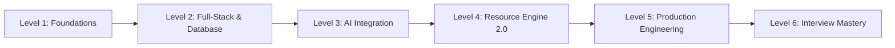

# Pencill — Developer Learning Roadmap

> **Your Structured, Step-by-Step Curriculum for Mastering the Pencill Codebase from Foundations to Senior Architect.**

---

## Roadmap Overview

---

## Level 1: Foundations
*Goal: Understand the project structure, TypeScript configuration, React component hierarchy, and Next.js request lifecycle.*

### 1. Concepts to Learn
* Next.js 14 App Router file conventions (`layout.tsx`, `page.tsx`, `error.tsx`, route groups).
* Server Components vs. Client Components (`"use client"`).
* TypeScript strict mode, path aliases (`@/*`), and shared domain interfaces.
* Utility styling with Tailwind CSS and CSS variables.

### 2. Exact Files to Read
1. [`package.json`](file:///c:/Users/Abhinav/Documents/Projects/Pencill%20Find%20Your%20Path/package.json) & [`tsconfig.json`](file:///c:/Users/Abhinav/Documents/Projects/Pencill%20Find%20Your%20Path/tsconfig.json)
2. [`src/app/layout.tsx`](file:///c:/Users/Abhinav/Documents/Projects/Pencill%20Find%20Your%20Path/src/app/layout.tsx) & [`src/app/globals.css`](file:///c:/Users/Abhinav/Documents/Projects/Pencill%20Find%20Your%20Path/src/app/globals.css)
3. [`src/types/index.ts`](file:///c:/Users/Abhinav/Documents/Projects/Pencill%20Find%20Your%20Path/src/types/index.ts)
4. [`src/components/cards/PathCard.tsx`](file:///c:/Users/Abhinav/Documents/Projects/Pencill%20Find%20Your%20Path/src/components/cards/PathCard.tsx)

### 3. Key Functions & Types to Understand
* Type `LearningPath`, `Module`, `Lesson` in [`src/types/index.ts`](file:///c:/Users/Abhinav/Documents/Projects/Pencill%20Find%20Your%20Path/src/types/index.ts#L1-L60).
* `cn()` class merge utility in [`src/lib/utils.ts`](file:///c:/Users/Abhinav/Documents/Projects/Pencill%20Find%20Your%20Path/src/lib/utils.ts).

### 4. Questions You Should Be Able to Answer
1. Why does `PathCard.tsx` not make any direct API calls?
2. What is the purpose of route groups like `(dashboard)`?
3. How does Next.js know which components should be sent to the browser as JavaScript?

### 5. Hands-on Exercise
Run `npm run lint` and `npx tsc --noEmit` locally. Verify that the TypeScript compiler reports 0 errors.

### 6. Checkpoint
Explain the difference between a React Server Component and a Client Component to another developer without looking at notes.

---

## Level 2: Full-Stack Development & Database Persistence
*Goal: Master route handlers, Zod validation, Supabase PostgreSQL, and Row Level Security.*

### 1. Concepts to Learn
* HTTP Route Handlers in Next.js (`NextRequest`, `NextResponse`).
* Runtime payload validation with Zod (`safeParse`).
* PostgreSQL schema design, foreign keys with `ON DELETE CASCADE`, and JSONB columns.
* Supabase Row Level Security (RLS) policies and tenant isolation.
* Persistent deletion registry and multi-tier enrollment caching.

### 2. Exact Files to Read
1. [`src/lib/api-schemas.ts`](file:///c:/Users/Abhinav/Documents/Projects/Pencill%20Find%20Your%20Path/src/lib/api-schemas.ts)
2. [`src/services/supabase/client.ts`](file:///c:/Users/Abhinav/Documents/Projects/Pencill%20Find%20Your%20Path/src/services/supabase/client.ts)
3. [`src/services/supabase/pathService.ts`](file:///c:/Users/Abhinav/Documents/Projects/Pencill%20Find%20Your%20Path/src/services/supabase/pathService.ts#L105-L250)
4. [`src/services/supabase/deletionRegistry.ts`](file:///c:/Users/Abhinav/Documents/Projects/Pencill%20Find%20Your%20Path/src/services/supabase/deletionRegistry.ts)
5. [`supabase/migrations/20260921000000_pencill_core_schema.sql`](file:///c:/Users/Abhinav/Documents/Projects/Pencill%20Find%20Your%20Path/supabase/migrations/20260921000000_pencill_core_schema.sql)

### 3. Key Functions to Understand
* `createFullLearningPath()` in [`pathService.ts`](file:///c:/Users/Abhinav/Documents/Projects/Pencill%20Find%20Your%20Path/src/services/supabase/pathService.ts#L494).
* `recordDeletedItem()` & `getDeletedItemIds()` in [`deletionRegistry.ts`](file:///c:/Users/Abhinav/Documents/Projects/Pencill%20Find%20Your%20Path/src/services/supabase/deletionRegistry.ts#L137).
* `canDeleteLearningPath()` in [`src/lib/permissions.ts`](file:///c:/Users/Abhinav/Documents/Projects/Pencill%20Find%20Your%20Path/src/lib/permissions.ts#L58).

### 4. Questions You Should Be Able to Answer
1. Why does the database table name `learning_paths` differ from the UI route `/courses`?
2. How does the deletion registry prevent deleted courses from reappearing on `F5` refresh?
3. Why does Pencill NOT use `SUPABASE_SERVICE_ROLE_KEY`?

### 5. Hands-on Exercise
Run `npx tsx scripts/check-supabase-db.ts` to inspect the live PostgreSQL table structures.

### 6. Checkpoint
Trace what happens in the database when a user deletes a course they authored.

---

## Level 3: AI Integration & Curriculum Synthesis
*Goal: Master LLM prompt engineering, model fallback cascades, structured JSON parsing, and deterministic fallback engines.*

### 1. Concepts to Learn
* Direct REST communication with Google Gemini Generative Language API.
* Model fallback cascades (`gemini-3.8-flash` -> `gemini-3.5-flash` -> `gemini-flash-latest`).
* Extracting structured JSON with LaTeX backslash sanitization.
* Dynamic topic-adaptive curriculum scaling vs. arbitrary fixed module limits.
* Deterministic curriculum synthesis (`createTopicAdaptiveCurriculum`).

### 2. Exact Files to Read
1. [`src/services/ai/gemini/client.ts`](file:///c:/Users/Abhinav/Documents/Projects/Pencill%20Find%20Your%20Path/src/services/ai/gemini/client.ts)
2. [`src/services/ai/gemini/geminiProvider.ts`](file:///c:/Users/Abhinav/Documents/Projects/Pencill%20Find%20Your%20Path/src/services/ai/gemini/geminiProvider.ts)
3. [`src/services/ai/curriculum-adaptive-engine.ts`](file:///c:/Users/Abhinav/Documents/Projects/Pencill%20Find%20Your%20Path/src/services/ai/curriculum-adaptive-engine.ts)
4. [`src/lib/resource-engine-v2/utils/text-utils.ts`](file:///c:/Users/Abhinav/Documents/Projects/Pencill%20Find%20Your%20Path/src/lib/resource-engine-v2/utils/text-utils.ts)

### 3. Key Functions to Understand
* `callGemini()` in [`client.ts`](file:///c:/Users/Abhinav/Documents/Projects/Pencill%20Find%20Your%20Path/src/services/ai/gemini/client.ts#L66).
* `generateLearningPath()` in [`geminiProvider.ts`](file:///c:/Users/Abhinav/Documents/Projects/Pencill%20Find%20Your%20Path/src/services/ai/gemini/geminiProvider.ts#L62).
* `createTopicAdaptiveCurriculum()` & `inferDomain()` in [`curriculum-adaptive-engine.ts`](file:///c:/Users/Abhinav/Documents/Projects/Pencill%20Find%20Your%20Path/src/services/ai/curriculum-adaptive-engine.ts#L476).
* `extractJsonFromText()` in [`text-utils.ts`](file:///c:/Users/Abhinav/Documents/Projects/Pencill%20Find%20Your%20Path/src/lib/resource-engine-v2/utils/text-utils.ts).

### 4. Questions You Should Be Able to Answer
1. Why doesn't Pencill use the official `@google/genai` npm SDK?
2. What happens if Gemini returns an HTTP 503 high demand error?
3. How does `extractJsonFromText` prevent JSON parsing crashes when LaTeX formulas contain backslashes?

### 5. Hands-on Exercise
Run `node scripts/test-gemini.mjs` to test live Gemini REST connectivity and observe structured output.

### 6. Checkpoint
Explain why a topic like "Python Decorators" generates 2 modules while "Machine Learning & LLMs" generates 5 modules.

---

## Level 4: Resource Engine 2.0 Deep Dive
*Goal: Understand the autonomous discovery, scoring, deduplication, and module distribution algorithms.*

### 1. Concepts to Learn
* Objective analysis and cognitive intent classification.
* Intent-aware search query formulation.
* Bounded concurrency provider execution (`runWithConcurrencyLimit`).
* Mathematical composite ranking formula and quality weights.
* Modality suitability gating (blocking research papers for high school topics).
* Cross-module deduplication and description chapter timestamp extraction.

### 2. Exact Files to Read
1. [`src/lib/resource-engine-v2/orchestrator.ts`](file:///c:/Users/Abhinav/Documents/Projects/Pencill%20Find%20Your%20Path/src/lib/resource-engine-v2/orchestrator.ts)
2. [`src/lib/resource-engine-v2/analysis/objective-analyzer.ts`](file:///c:/Users/Abhinav/Documents/Projects/Pencill%20Find%20Your%20Path/src/lib/resource-engine-v2/analysis/objective-analyzer.ts)
3. [`src/lib/resource-engine-v2/evaluation/ranking-engine.ts`](file:///c:/Users/Abhinav/Documents/Projects/Pencill%20Find%20Your%20Path/src/lib/resource-engine-v2/evaluation/ranking-engine.ts)
4. [`src/lib/resource-engine-v2/providers/youtube-adapter.ts`](file:///c:/Users/Abhinav/Documents/Projects/Pencill%20Find%20Your%20Path/src/lib/resource-engine-v2/providers/youtube-adapter.ts)
5. [`src/lib/resource-engine-v2/distribution/module-distributor.ts`](file:///c:/Users/Abhinav/Documents/Projects/Pencill%20Find%20Your%20Path/src/lib/resource-engine-v2/distribution/module-distributor.ts)
6. [`src/lib/resource-engine-v2/chapters/chapter-resolver.ts`](file:///c:/Users/Abhinav/Documents/Projects/Pencill%20Find%20Your%20Path/src/lib/resource-engine-v2/chapters/chapter-resolver.ts)

### 3. Key Functions to Understand
* `ResourceEngineV2.discover()` in [`orchestrator.ts`](file:///c:/Users/Abhinav/Documents/Projects/Pencill%20Find%20Your%20Path/src/lib/resource-engine-v2/orchestrator.ts#L161).
* `ExplainableRankingEngine.rank()` in [`ranking-engine.ts`](file:///c:/Users/Abhinav/Documents/Projects/Pencill%20Find%20Your%20Path/src/lib/resource-engine-v2/evaluation/ranking-engine.ts#L85).
* `isModalityAppropriateForObjective()` in [`ranking-engine.ts`](file:///c:/Users/Abhinav/Documents/Projects/Pencill%20Find%20Your%20Path/src/lib/resource-engine-v2/evaluation/ranking-engine.ts#L20).
* `extractChaptersFromDescription()` in [`chapter-resolver.ts`](file:///c:/Users/Abhinav/Documents/Projects/Pencill%20Find%20Your%20Path/src/lib/resource-engine-v2/chapters/chapter-resolver.ts#L32).

### 4. Questions You Should Be Able to Answer
1. Why does the engine reject videos with `status.embeddable == false`?
2. What are the 4 weights in the ranking equation, and why is relevance 50%?
3. How does the engine ensure different modules in the same course do not receive the same video?

### 5. Hands-on Exercise
Run `npx tsx scripts/verify-actual-engine.ts` to inspect how topics match educators from the Master Dataset.

### 6. Checkpoint
Calculate by hand the composite score of a 45-minute Abdul Bari algorithm lecture using the ranking formula.

---

## Level 5: Production Engineering, Testing & Security
*Goal: Understand resilience, circuit breakers, automated testing, and security boundaries.*

### 1. Concepts to Learn
* Circuit Breaker patterns for protecting external API quotas.
* Node.js native test runner and running the 472-test suite.
* Privacy-preserving video playback via `youtube-nocookie.com`.
* Answer key isolation in diagnostic assessments.
* Offline-first guest data migration into PostgreSQL.

### 2. Exact Files to Read
1. [`src/lib/resource-engine-v2/resilience/circuit-breaker.ts`](file:///c:/Users/Abhinav/Documents/Projects/Pencill%20Find%20Your%20Path/src/lib/resource-engine-v2/resilience/circuit-breaker.ts)
2. [`src/services/supabase/quizService.ts`](file:///c:/Users/Abhinav/Documents/Projects/Pencill%20Find%20Your%20Path/src/services/supabase/quizService.ts#L290-L330)
3. [`src/services/supabase/migrationService.ts`](file:///c:/Users/Abhinav/Documents/Projects/Pencill%20Find%20Your%20Path/src/services/supabase/migrationService.ts)
4. [`tests/critical-regressions-audit.test.ts`](file:///c:/Users/Abhinav/Documents/Projects/Pencill%20Find%20Your%20Path/tests/critical-regressions-audit.test.ts)

### 3. Hands-on Exercise
Run `npm test` and verify that all 472 tests pass in under 15 seconds.

### 4. Checkpoint
Explain why answer keys (`correctOptionId`) are stripped from `GET /api/quizzes/[id]` requests and how this prevents student cheating.

---

## Level 6: Technical Interview Mastery
*Goal: Confidently explain, whiteboard, and defend Pencill in a senior technical interview.*

### 1. Key Tasks
1. Memorize and practice the 30-second, 90-second, and 3-minute project explanations in [`INTERVIEW_MASTER_GUIDE.md`](file:///c:/Users/Abhinav/Documents/Projects/Pencill%20Find%20Your%20Path/docs/interview/INTERVIEW_MASTER_GUIDE.md#1-project-introductions).
2. Practice whiteboarding Diagram A (System Architecture) and Diagram E (Entity-Relationship Diagram) from [`SYSTEM_ARCHITECTURE.md`](file:///c:/Users/Abhinav/Documents/Projects/Pencill%20Find%20Your%20Path/docs/architecture/SYSTEM_ARCHITECTURE.md).
3. Review the 75 High-Yield Technical Flashcards in [`INTERVIEW_MASTER_GUIDE.md`](file:///c:/Users/Abhinav/Documents/Projects/Pencill%20Find%20Your%20Path/docs/interview/INTERVIEW_MASTER_GUIDE.md#7-75-high-yield-technical-flashcards) until you can answer every question rapidly.
4. Prepare honest answers for difficult interview challenge questions (e.g., "Why not just use ChatGPT?", "How do you ground quizzes in video content?").
